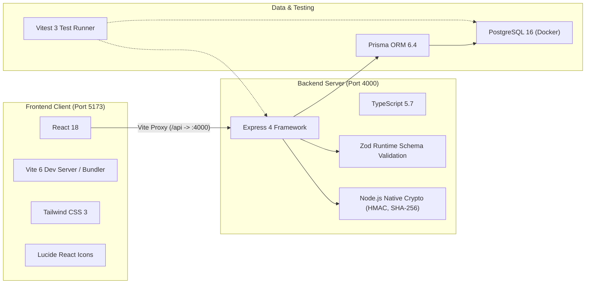
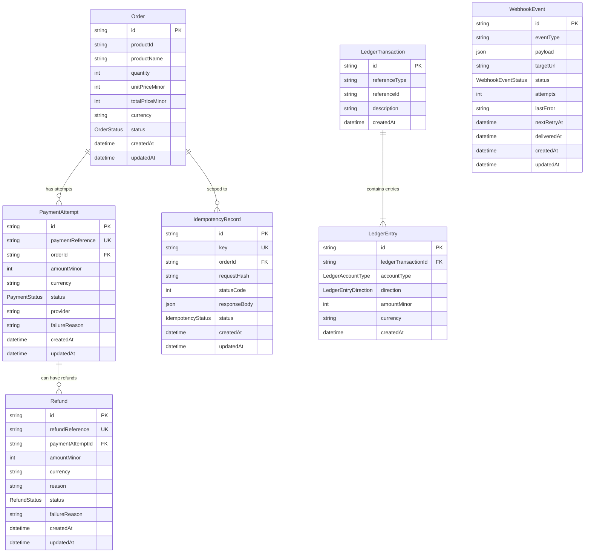
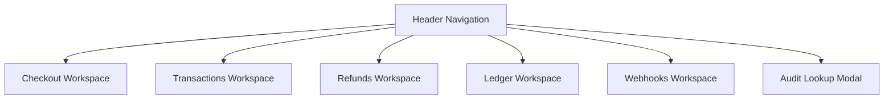

# PayFlow — Architecture Deep Dive & SDE Interview Master Guide

> **Target Audience:** Internal Developer Study Notes & SDE Interview Preparation Guide.
> **Scope:** Full-depth technical explanation from basic concepts to low-level implementation details, failure modes, concurrency protections, and 30+ interview questions with model answers.

---

## Table of Contents

1. [Project in Plain English](#1-project-in-plain-english)
2. [Complete Technology Stack](#2-complete-technology-stack)
3. [End-to-End Architecture & Request Flow](#3-end-to-end-architecture--request-flow)
4. [Repository Walkthrough & File-by-File Mapping](#4-repository-walkthrough--file-by-file-mapping)
5. [Database Architecture & Prisma Schema Deep Dive](#5-database-architecture--prisma-schema-deep-dive)
6. [Orders vs. Payment Attempts & State Machine](#6-orders-vs-payment-attempts--state-machine)
7. [Idempotency & Duplicate Request Protection](#7-idempotency--duplicate-request-protection)
8. [Money Representation & Double-Entry Ledger](#8-money-representation--double-entry-ledger)
9. [Atomic Refunds & PostgreSQL Concurrency Control](#9-atomic-refunds--postgresql-concurrency-control)
10. [Webhooks & The Transactional Outbox Pattern](#10-webhooks--the-transactional-outbox-pattern)
11. [Timeouts, Uncertainty & Safe Reconciliation](#11-timeouts-uncertainty--safe-reconciliation)
12. [Validation, Error Handling & Security](#12-validation-error-handling--security)
13. [Frontend Architecture & UI Workspaces](#13-frontend-architecture--ui-workspaces)
14. [Debugging Case Studies & Production Lessons](#14-debugging-case-studies--production-lessons)
15. [Automated Testing Suite (68 Tests Verified)](#15-automated-testing-suite-68-tests-verified)
16. [Current Limitations & Architectural Trade-offs](#16-current-limitations--architectural-trade-offs)
17. [SDE Interview Preparation: Pitch, 30+ Q&A, and Traps](#17-sde-interview-preparation-pitch-30-qa-and-traps)
18. [Concept Mastery Checklist](#18-concept-mastery-checklist)

---

## 1. Project in Plain English

### The Real-World Analogies

To understand PayFlow without jargon, think of three everyday situations:

1. **The Double-Clicking Restaurant Customer (Idempotency):**
   Imagine ordering dinner via a food delivery app with an unstable mobile connection. You tap "Pay Now", the screen freezes for 4 seconds, so you furiously tap "Pay Now" two more times.
   *A naive payment system* would charge your bank card three separate times for one meal.
   *PayFlow* attaches a unique tag (`Idempotency-Key: idemp_123`) to your request. When the second and third requests arrive, the server detects the tag, recognizes that the request was already executed, and immediately returns the original receipt without charging your account again.

2. **The Bank Teller's Ledger Book (Double-Entry Bookkeeping):**
   When money moves in a bank, it doesn't vanish from one place and reappear in another by magic. If you give a teller ₹1,000 cash to deposit into a merchant's account:
   - The teller writes: **Debit Cash Vault (+₹1,000)**.
   - The teller writes: **Credit Merchant Account (+₹1,000)**.
   The sum of debits must equal the sum of credits. If the teller's book doesn't balance to the single rupee, the bank cannot close for the day. PayFlow implements this exact rule mathematically in software.

3. **The Courier Outbox (Transactional Outbox):**
   Suppose you sign an important legal contract and want to courier a notification to the other party.
   *Bad approach:* You sign the contract, pick up your phone to call the courier, but your phone dies. You drop the contract, panicking because you don't know whether the courier heard you or whether the contract is legally binding.
   *Outbox approach:* When you sign the contract and file it in your cabinet, you simultaneously drop a sealed envelope into an outgoing mail tray on your desk inside the same secure room. Once the door is locked, the document is officially filed. Later, the mail clerk collects outgoing envelopes and delivers them. If delivery fails because the recipient is not home, the clerk retries later—the contract itself is never cancelled.

### The Problem PayFlow Solves

When building payments systems, networks fail, servers crash midway through operations, clients retry indiscriminately, and concurrent requests race against each other.

PayFlow demonstrates how to build a payment gateway sandbox that handles:
- **Duplicate charges** via cryptographic idempotency hashing.
- **Floating-point money bugs** by enforcing integer minor units (paise).
- **Over-refunding under concurrency** using PostgreSQL database row-level locking (`SELECT ... FOR UPDATE`).
- **Network timeouts** by isolating uncertain states instead of blindly retrying.
- **Lost or duplicate merchant notifications** via a transactional outbox with HMAC-SHA256 signatures.

### What PayFlow Is vs. What It Is Not

| What PayFlow IS | What PayFlow IS NOT |
| :--- | :--- |
| An educational architectural reference implementation. | A licensed financial institution or live processor. |
| A demonstration of ACID database transactions & row locking. | A PCI-DSS certified credit card vault. |
| A deterministic sandbox with simulated payment outcomes. | Connected to real Visa/Mastercard/UPI banking rails. |
| A single-process monorepo for local learning and interviews. | A multi-region distributed cloud cluster. |

---

## 2. Complete Technology Stack



### 1. React 18 & TypeScript (Frontend)
- **Role:** Interactive single-page application dashboard.
- **Why Chosen:** Provides component-driven reactivity with strict compile-time type safety. Components share domain interfaces (`PaymentAttempt`, `Refund`, `LedgerTransaction`, `WebhookEvent`) directly matching backend response structures.
- **Location:** `frontend/src/`

### 2. Vite 6
- **Role:** Fast development server and production bundler.
- **Why Chosen:** Sub-second Hot Module Replacement (HMR) and built-in reverse proxy configuration (`/api` routed to `http://localhost:4000`) that eliminates browser Cross-Origin Resource Sharing (CORS) friction during local development.
- **Config:** `frontend/vite.config.ts`

### 3. Node.js & Express 4 (Backend)
- **Role:** REST API server handling request parsing, routing, and controller execution.
- **Why Chosen:** Predictable event-loop model, native asynchronous I/O, and rich ecosystem for middleware pipelines.
- **Entry Points:** `backend/src/app.ts`, `backend/src/server.ts`

### 4. Zod 3
- **Role:** Runtime schema validation middleware.
- **Why Chosen:** TypeScript types vanish at runtime during compilation. Zod validates incoming HTTP JSON payloads at runtime before they reach service logic, blocking malformed numbers, missing fields, or invalid enum outcomes.
- **Implementation:** `backend/src/middleware/validate.ts`

### 5. PostgreSQL 16 & Prisma ORM 6
- **Role:** Relational database with ACID guarantees, foreign keys, row-level locks, and automated migrations.
- **Why Chosen:** Fintech requires strict transactional consistency. PostgreSQL provides true `SERIALIZABLE` and `READ COMMITTED` isolation levels, native row-level locking (`FOR UPDATE`), and rock-solid relational integrity. Prisma provides type-safe query generation and migration tracking.
- **Schema & Migrations:** `backend/prisma/schema.prisma`, `backend/prisma/migrations/`

### 6. Vitest 3 & Supertest 7
- **Role:** Unit, integration, and HTTP end-to-end testing framework.
- **Why Chosen:** High execution speed, native TypeScript support via Vite's transform pipeline, and in-memory mock integration alongside live PostgreSQL integration testing.
- **Tests:** `backend/tests/`

---

## 3. End-to-End Architecture & Request Flow

### Detailed Trace of a Successful Payment (₹999.00 / 99,900 paise)

```mermaid
sequenceDiagram
    autonumber
    actor User as Customer / Browser
    participant APIClient as frontend/src/services/api.ts
    participant OrderRoute as POST /api/v1/orders
    participant PaymentRoute as POST /api/v1/payments
    participant Validate as Zod Validation Middleware
    participant PaymentService as backend/src/modules/payments/payment.service.ts
    participant StateMachine as backend/src/modules/payments/payment.state-machine.ts
    participant MockProvider as backend/src/modules/payments/mock-provider.service.ts
    participant LedgerService as backend/src/modules/ledger/ledger.service.ts
    participant WebhookService as backend/src/modules/webhooks/webhook.service.ts
    participant DB as PostgreSQL 16 (Prisma Transaction)

    User->>APIClient: Click "Pay ₹999.00"
    APIClient->>OrderRoute: POST { productId: "prod_sample_001", quantity: 1 }
    OrderRoute->>DB: Server looks up product catalog (unitPrice: 99900 paise)
    DB-->>OrderRoute: Insert Order (status: CREATED, totalPriceMinor: 99900)
    OrderRoute-->>APIClient: Order Created (id: ord_123)

    APIClient->>PaymentRoute: POST { orderId: "ord_123", simulatedOutcome: "SUCCESS", paymentMethod: "UPI" }<br/>Header: Idempotency-Key: idemp_abc
    PaymentRoute->>Validate: Validate Zod Schema
    Validate-->>PaymentRoute: Validated Payload

    PaymentRoute->>PaymentService: processPayment(input, idempotencyKey)
    PaymentService->>DB: Check idempotency_records WHERE key = "idemp_abc"
    Note over PaymentService,DB: No record found (new request)

    PaymentService->>DB: Atomic Update: orders SET status='PROCESSING' WHERE id='ord_123' AND status='CREATED'
    Note over PaymentService,DB: Prevents concurrent attempts from charging the same order

    PaymentService->>DB: Insert idempotency_records (status: PROCESSING, requestHash: sha256)
    PaymentService->>DB: Insert payment_attempts (status: CREATED, amount: 99900)
    PaymentService->>StateMachine: assertValidTransition(CREATED, PROCESSING)
    PaymentService->>DB: Update payment_attempts SET status = 'PROCESSING'

    PaymentService->>MockProvider: processPayment(reference, 99900, "INR", "SUCCESS")
    MockProvider-->>PaymentService: { status: "SUCCESS", transactionId: "mock_tx_999" }

    PaymentService->>StateMachine: assertValidTransition(PROCESSING, SUCCEEDED)

    rect rgb(15, 30, 45)
        Note over PaymentService,DB: ATOMIC DATABASE COMMIT
        PaymentService->>DB: Update payment_attempts SET status = 'SUCCEEDED'
        PaymentService->>DB: Update orders SET status = 'COMPLETED'
        PaymentService->>LedgerService: recordPaymentCapture(paymentId, 99900, "INR", tx)
        LedgerService->>DB: Insert ledger_transactions & 2 balanced entries<br/>(DEBIT Customer Funds 99900, CREDIT Merchant Settlement 99900)
        PaymentService->>WebhookService: createEvent("payment.succeeded", payload, null, tx)
        WebhookService->>DB: Insert webhook_events (status: PENDING, attempts: 0)
        PaymentService->>DB: Update idempotency_records SET status = 'RESOLVED', responseBody = payment
    end

    PaymentService-->>PaymentRoute: Payment Object (SUCCEEDED)
    PaymentRoute-->>APIClient: HTTP 201 Created (JSON Response)
    APIClient-->>User: Re-render UI with Success Card, Ledger Entry, and Webhook Badge
```



---

## 4. Repository Walkthrough & File-by-File Mapping

```text
payflow-node/
├── backend/
│   ├── prisma/
│   │   ├── schema.prisma                      # Database models, constraints, and indexes
│   │   └── migrations/                        # Applied SQL DDL migrations
│   ├── src/
│   │   ├── app.ts                             # Express setup, middleware stack, route mounting
│   │   ├── server.ts                          # Server listener and SIGINT/SIGTERM handlers
│   │   ├── config/index.ts                    # Environment configuration loader
│   │   ├── db/prisma.ts                       # PrismaClient singleton
│   │   ├── errors/app-error.ts                # AppError with HTTP status & error codes
│   │   ├── middleware/
│   │   │   ├── error-handler.ts               # Global JSON error formatting & masking
│   │   │   └── validate.ts                    # Zod request validation middleware
│   │   ├── modules/
│   │   │   ├── health/
│   │   │   │   ├── health.controller.ts       # Health endpoint controller
│   │   │   │   └── health.routes.ts           # GET /api/v1/health
│   │   │   ├── orders/
│   │   │   │   ├── order.controller.ts        # Order creation & retrieval handlers
│   │   │   │   ├── order.routes.ts            # /api/v1/orders routing
│   │   │   │   ├── order.schema.ts            # Zod validation for orders
│   │   │   │   └── order.service.ts           # Server-authoritative product catalog pricing
│   │   │   ├── payments/
│   │   │   │   ├── mock-provider.service.ts   # Simulated provider (SUCCESS, DECLINE, TIMEOUT)
│   │   │   │   ├── payment.controller.ts      # Payment creation & reconciliation handlers
│   │   │   │   ├── payment.routes.ts          # /api/v1/payments routing
│   │   │   │   ├── payment.schema.ts          # Zod validation for payment & reconciliation
│   │   │   │   ├── payment.service.ts         # Payment orchestration, idempotency & lifecycle
│   │   │   │   └── payment.state-machine.ts   # State machine guards & terminal state checks
│   │   │   ├── refunds/
│   │   │   │   ├── refund.controller.ts       # Refund request handlers
│   │   │   │   ├── refund.routes.ts           # /api/v1/payments/:id/refunds & /api/v1/refunds
│   │   │   │   ├── refund.schema.ts           # Zod schema for refund inputs
│   │   │   │   └── refund.service.ts          # SELECT FOR UPDATE row locking & balance check
│   │   │   ├── ledger/
│   │   │   │   ├── ledger.controller.ts       # Ledger transaction inspection handlers
│   │   │   │   ├── ledger.routes.ts           # /api/v1/ledger routing
│   │   │   │   └── ledger.service.ts          # Balanced double-entry transaction poster
│   │   │   └── webhooks/
│   │   │       ├── webhook.controller.ts      # Webhook outbox & test target handlers
│   │   │       ├── webhook.crypto.ts          # HMAC-SHA256 signer & constant-time verifier
│   │   │       ├── webhook.routes.ts          # /api/v1/webhooks routing
│   │   │       └── webhook.service.ts         # Webhook outbox delivery & backoff retries
│   │   └── types/index.ts                     # Shared TypeScript interfaces & enums
│   └── tests/                                 # 68 Vitest unit & live integration tests
```

---

## 5. Database Architecture & Prisma Schema Deep Dive

### Entity-Relationship Diagram



### Model Deep Dive

1. **`Order` (`orders`)**
   - **`unitPriceMinor` & `totalPriceMinor`:** Non-nullable integers. Server multiplies `unitPriceMinor * quantity` directly from the catalog.
   - **Indexes:** `status`, `createdAt`.
2. **`PaymentAttempt` (`payment_attempts`)**
   - **`paymentReference`:** Unique string (`pay_1729..._abc123`).
   - **`status`:** Enum (`CREATED`, `PROCESSING`, `SUCCEEDED`, `FAILED`, `UNCERTAIN`).
   - **Foreign Key:** `orderId` references `Order.id` with `onDelete: Cascade`.
3. **`IdempotencyRecord` (`idempotency_records`)**
   - **`key`:** Unique string indexed for $O(1)$ lookups.
   - **`requestHash`:** SHA-256 hex digest of sorted, normalized request parameters.
   - **`responseBody`:** Cached JSON representation returned verbatim on replays.
4. **`LedgerTransaction` (`ledger_transactions`)**
   - **`@@unique([referenceType, referenceId])`:** Composite unique constraint preventing double-posting of any payment capture or refund.
5. **`LedgerEntry` (`ledger_entries`)**
   - **`accountType`:** Enum (`CUSTOMER_FUNDS`, `MERCHANT_SETTLEMENT`).
   - **`direction`:** Enum (`DEBIT`, `CREDIT`).
   - **`amountMinor`:** Positive integer in paise.
6. **`Refund` (`refunds`)**
   - **`refundReference`:** Unique identifier (`ref_1729..._xyz789`).
   - **`paymentAttemptId`:** Foreign key to parent captured payment.
7. **`WebhookEvent` (`webhook_events`)**
   - **Outbox Model:** Stores event payload, target endpoint, delivery attempt counter, error diagnostics, and backoff timestamp.

---

## 6. Orders vs. Payment Attempts & State Machine

### Why Separate `Order` from `PaymentAttempt`?

In real-world e-commerce, **an order represents an intent to purchase items**, whereas **a payment attempt represents a single interaction with financial payment rails**.

1. **Multiple Attempts per Order:** A customer might try UPI, enter an expired PIN (Attempt 1: `FAILED`), and then try Credit Card (Attempt 2: `SUCCEEDED`).
2. **Single Fulfillment:** While an order may have multiple payment attempts, it must transition to `COMPLETED` at most once.

### State Machine Implementation

Governed in `backend/src/modules/payments/payment.state-machine.ts`:

```typescript
const VALID_TRANSITIONS: Record<PaymentStatus, PaymentStatus[]> = {
  [PaymentStatus.CREATED]: [PaymentStatus.PROCESSING],
  [PaymentStatus.PROCESSING]: [PaymentStatus.SUCCEEDED, PaymentStatus.FAILED, PaymentStatus.UNCERTAIN],
  [PaymentStatus.UNCERTAIN]: [PaymentStatus.SUCCEEDED, PaymentStatus.FAILED],
  [PaymentStatus.SUCCEEDED]: [], // Terminal state
  [PaymentStatus.FAILED]: [],    // Terminal state
};
```

- **Terminal State Immunity:** Once a payment enters `SUCCEEDED` or `FAILED`, `isTerminalState()` returns `true`. Any further transition attempt throws HTTP 409 `TERMINAL_STATE_CONFLICT`.

---

## 7. Idempotency & Duplicate Request Protection

### The Duplicate-Request Threat Model

1. **Client Double Click:** Customer clicks "Pay" twice in rapid succession.
2. **Network Flakiness:** The server processes the payment successfully, but the network connection drops before the HTTP response reaches the browser. The browser retries automatically.
3. **Malicious Replay:** An attacker intercepts a request and replays it to drain an account.

### How PayFlow Implements Idempotency

Located in `backend/src/modules/payments/payment.service.ts`:

1. **Payload Normalization & Hashing:**
   The request payload is normalized (sorted keys, trimmed strings) and hashed using SHA-256:
   ```typescript
   const requestHash = crypto.createHash('sha256').update(JSON.stringify(normalized)).digest('hex');
   ```
2. **Database Lookup:**
   The server checks `prisma.idempotencyRecord.findUnique({ where: { key } })`:
   - **Case A (Payload Mismatch):** The key exists, but `requestHash !== existingRecord.requestHash`. The server aborts with **HTTP 409 Conflict** (`IDEMPOTENCY_PAYLOAD_MISMATCH`). A client cannot reuse an idempotency key for a different charge.
   - **Case B (Concurrent Request):** The key exists with `status: 'PROCESSING'`. Another thread or request is currently processing this charge. The server aborts with **HTTP 409 Conflict** (`CONCURRENT_IDEMPOTENCY_REQUEST`).
   - **Case C (Identical Replay):** The key exists with `status: 'RESOLVED'`. The server returns the cached `responseBody` with the header **`Idempotent-Replay: true`**. No payment provider is contacted; no new database attempt is created.
   - **Case D (New Request):** The key does not exist. A record is created in `PROCESSING` state within the database.

---

## 8. Money Representation & Double-Entry Ledger

### The Floating-Point Trap (IEEE 754)

In JavaScript:
```javascript
0.1 + 0.2 // Returns 0.30000000000000004
```
If you store ₹999.00 as `999.00` in a `FLOAT` or `DOUBLE` database column, roundoff errors accumulate during tax, discount, or partial refund calculations, creating unexplainable accounting variances.

**PayFlow Solution:** All monetary fields are typed as **integers in minor units (paise)**:
- ₹999.00 = `99900` paise
- ₹0.50 = `50` paise
- Currency is stored explicitly as `"INR"`.

### Double-Entry Accounting Invariant

Located in `backend/src/modules/ledger/ledger.service.ts`:

Every financial event must balance across accounts:
$$\sum \text{Debits} = \sum \text{Credits}$$

#### 1. Payment Capture Settlement:
- **Debit:** `CUSTOMER_FUNDS` (₹999.00 / 99,900 paise)
- **Credit:** `MERCHANT_SETTLEMENT` (₹999.00 / 99,900 paise)
*Balance Check: 99900 - 99900 = 0.*

#### 2. Refund Reversal:
- **Debit:** `MERCHANT_SETTLEMENT` (₹400.00 / 40,000 paise)
- **Credit:** `CUSTOMER_FUNDS` (₹400.00 / 40,000 paise)
*Balance Check: 40000 - 40000 = 0.*

If any transaction is submitted where `totalDebits !== totalCredits`, the service throws HTTP 400 `UNBALANCED_LEDGER_TRANSACTION` before writing anything to disk.

---

## 9. Atomic Refunds & PostgreSQL Concurrency Control

### The Over-Refund Race Condition

Suppose a customer makes a ₹999 payment. Two customer support agents simultaneously issue partial refunds of ₹700 each:

```text
Time    Agent A (Refund ₹700)                 Agent B (Refund ₹700)
-------------------------------------------------------------------------
T1      Read captured: ₹999                   Read captured: ₹999
T2      Read refunded: ₹0                     Read refunded: ₹0
T3      Calculates remaining: ₹999            Calculates remaining: ₹999
T4      ₹700 <= ₹999 (Valid!)                 ₹700 <= ₹999 (Valid!)
T5      Writes Refund ₹700                    Writes Refund ₹700
-------------------------------------------------------------------------
Result: Total refunded = ₹1,400 on a ₹999 purchase (A ₹401 financial loss!)
```

### The PayFlow Fix: Row-Level Locking

Located in `backend/src/modules/refunds/refund.service.ts`:

Inside `prisma.$transaction(async (tx) => { ... })`:
```sql
SELECT id FROM payment_attempts WHERE id = $1 FOR UPDATE;
```
1. **Pessimistic Row Lock:** When Agent A's request hits the row lock, Agent B's request is paused by PostgreSQL until Agent A's transaction commits or aborts.
2. **Recalculation Under Lock:** When Agent B's lock is granted, Agent B recalculates existing refunds. Agent B reads `totalRefunded = 70000`, calculates `refundableBalance = 29900`, and rejects the second ₹700 request with **HTTP 400 `EXCEEDS_REFUNDABLE_BALANCE`**.
3. **Integration Proof:** Verified in `backend/tests/integration.db.test.ts` using `Promise.allSettled`.

---

## 10. Webhooks & The Transactional Outbox Pattern

### Why the Outbox Pattern?

Synchronously making an HTTP request to a merchant's server inside a database transaction is dangerous:
- If the merchant's server is down, slow, or times out, the database connection is held open, exhausting connection pools.
- If the network call times out, rolling back the database transaction reverses an already-settled customer charge.

### Implementation

1. **Transactional Persistence:**
   The webhook event is inserted into `webhook_events` within the payment or refund database transaction:
   - `status: PENDING`
   - `attempts: 0`
   - `deliveredAt: null`
2. **Cryptographic HMAC-SHA256 Signing:**
   Located in `backend/src/modules/webhooks/webhook.crypto.ts`:
   ```typescript
   const signature = crypto.createHmac('sha256', secret).update(`${timestamp}.${JSON.stringify(payload)}`).digest('hex');
   // Header: X-PayFlow-Signature: t=1729420000,v1=abcdef...
   ```
3. **Constant-Time Verification:**
   Signatures are verified using `crypto.timingSafeEqual` to eliminate timing attacks. Replays older than 300 seconds are rejected.
4. **Exponential Backoff:**
   $$\text{Backoff Seconds} = \min(2^{\text{attempts}} \times 5, 3600)$$
   Failed deliveries schedule retries at 10s, 20s, 40s... transitioning to `FAILED` after 5 attempts.

---

## 11. Timeouts, Uncertainty & Safe Reconciliation

### Why Timeouts Are Not Failures

When a payment provider gateway times out, the bank may have already debited the customer's account. Treating a timeout as a failure and immediately retrying can result in **duplicate charges**.

### PayFlow Reconciliation Workflow

1. Provider responds with `TIMEOUT`.
2. State machine transitions payment to `UNCERTAIN` and order remains in `PROCESSING`.
3. Merchant/developer inspects status in the UI or invokes:
   ```http
   POST /api/v1/payments/:id/reconcile
   Content-Type: application/json
   { "resolution": "SUCCESS" }
   ```
4. PayFlow queries the provider's inquiry endpoint without initiating a new charge. If confirmed, transitions to `SUCCEEDED`, completes the order, posts ledger entries, and emits the outbox webhook.

---

## 12. Validation, Error Handling & Security

1. **Runtime Zod Validation:**
   Located in `backend/src/middleware/validate.ts`. Prevents non-integer quantities, invalid simulated outcomes, or malformed payloads before hitting controllers.
2. **Centralized Error Hierarchy:**
   `backend/src/errors/app-error.ts` standardizes errors:
   ```json
   {
     "success": false,
     "error": {
       "code": "INVALID_STATE_TRANSITION",
       "message": "Illegal payment state transition from 'SUCCEEDED' to 'PROCESSING'"
     }
   }
   ```
3. **Safe Error Masking:**
   In production (`NODE_ENV=production`), database stack traces and internal query logs are masked from external HTTP responses.

---

## 13. Frontend Architecture & UI Workspaces

The frontend is structured into 5 dedicated workspaces plus an audit lookup modal:



- **Checkout Workspace:** Interactive ₹999 sample product, quantity controls, outcome selector (`SUCCESS`, `DECLINE`, `TIMEOUT`), and live status card with inline refund triggers.
- **Transactions Workspace:** Historical ledger of all payment attempts with status badges, attempt IDs, and one-click reconciliation for `UNCERTAIN` payments.
- **Refunds Workspace:** Summary metrics (total refunded, active refunds) and interactive refund forms enforcing integer paise balances.
- **Ledger Workspace:** Double-entry journal showing balanced transactions, debited/credited accounts, and ledger invariant verification.
- **Webhooks Workspace:** Outbox queue, HMAC signature header viewer, custom merchant destination URL input, and live **Test Deliver** trigger.
- **Audit Lookup Modal:** Query any transaction by `paymentReference` or `paymentId`.

---

## 14. Debugging Case Studies & Production Lessons

### Case Study 1: The Frontend `Content-Type` Header Overwrite Bug
- **Symptom:** On the Checkout page, payments failed with `Execution Error: Invalid request data` (HTTP 400).
- **Root Cause:** In `frontend/src/services/api.ts`, custom headers (`Idempotency-Key`) passed into `request()` were overriding or merging incorrectly with `Content-Type: application/json`. Express `express.json()` failed to parse the body, leaving `req.body` empty.
- **Fix:** Structured `request()` to unconditionally guarantee `'Content-Type': 'application/json'` while safely spreading custom headers.
- **Lesson:** Always ensure essential transport headers cannot be inadvertently clobbered by caller-provided headers.

### Case Study 2: The Silent Webhook Fake-Delivery Bug
- **Symptom:** Calling `/deliver` without specifying a destination URL marked the event as `DELIVERED` with `attempts: 1`, even though no HTTP request had occurred.
- **Root Cause:** In `backend/src/modules/webhooks/webhook.service.ts`, an empty `targetUrl` fell into a mock branch: `} else { isSuccess = true; }`.
- **Fix:** Removed the mock branch. If no target URL is configured, `isSuccess = false` with error `'No webhook target URL configured'`. Delivery is only marked `DELIVERED` upon receiving an actual `2xx` HTTP response from a real endpoint.
- **Lesson:** Never fake operational side-effects. In payments, treating unconfirmed actions as successful corrupts auditability.

### Case Study 3: The `maxAttempts` Display Bug
- **Symptom:** In the Webhooks outbox table, the Attempts column rendered `0 / ` and `1 / ` with a missing denominator.
- **Root Cause:** The frontend interface expected `maxAttempts: number`, but `maxAttempts` is a backend service constant (5), not a database column in the Prisma model.
- **Fix:** Updated frontend rendering to `{event.attempts} / {event.maxAttempts || 5}`.
- **Lesson:** Provide defensive UI fallbacks for metadata derived from service constants rather than database columns.

---

## 15. Automated Testing Suite (68 Tests Verified)

PayFlow maintains **68 automated tests** passing across 9 test suites:

```text
✓ tests/state-machine.test.ts      (10 tests) - State transitions & terminal immunity
✓ tests/ledger.test.ts             (5 tests)  - Debits === Credits invariant & integer paise
✓ tests/webhooks.test.ts           (12 tests) - HMAC generation, tamper resistance, retry backoff
✓ tests/health.test.ts             (1 test)   - System health & uptime diagnostics
✓ tests/orders.test.ts             (6 tests)  - Server pricing & Zod validation
✓ tests/payments.test.ts           (9 tests)  - Lifecycle, simulated declines, timeout transitions
✓ tests/refunds.test.ts            (8 tests)  - Refund bounds, partial calculations, over-refund checks
✓ tests/idempotency.test.ts        (10 tests) - Replay headers, payload mismatch 409, concurrency
✓ tests/integration.db.test.ts     (7 tests)  - PostgreSQL row locks, transactions, outbox dispatch
------------------------------------------------------------------------------------------------
Total: 68 passing (100%)
```

### Running Tests Locally

```bash
# Run complete test suite
npm --prefix backend test
```

---

## 16. Current Limitations & Architectural Trade-offs

1. **Simulated Payment Provider:** Provider interactions are mocked; real bank clearing houses or card schemes are not integrated.
2. **Absence of Background Outbox Worker:** Webhooks are dispatched via the interactive **Test Deliver** action or on-demand API calls. A continuous background queue processor (e.g. BullMQ / Redis) is omitted to keep local setup zero-dependency beyond PostgreSQL.
3. **Single Currency (INR):** Multi-currency exchange rate conversions are outside the sandbox scope.
4. **Single-Node Locking:** PostgreSQL row locks (`SELECT ... FOR UPDATE`) are used for concurrency control. In horizontally scaled multi-database architectures, distributed locks (e.g. Redis Redlock) would be required.

---

## 17. SDE Interview Preparation: Pitch, 30+ Q&A, and Traps

### 60-Second Elevator Pitch
> *"I built PayFlow, an educational payment gateway sandbox in TypeScript, Node.js, PostgreSQL, and React that demonstrates core fintech engineering fundamentals. The project enforces server-authoritative catalog pricing and stores all money strictly as integer paise to prevent floating-point rounding errors. I implemented an explicit finite state machine that models success, failure, and network timeouts as an explicit UNCERTAIN state that requires non-charging reconciliation. To guarantee payment reliability, PayFlow requires SHA-256 payload-hashed idempotency keys to safely handle retries, utilizes PostgreSQL `SELECT FOR UPDATE` row locks to prevent concurrent partial over-refunding, maintains a balanced double-entry ledger where debits equal credits, and implements a transactional outbox with HMAC-SHA256 signed webhooks. The entire backend is verified with 68 automated unit and live PostgreSQL integration tests."*

---

### 30+ Comprehensive Interview Questions & Model Answers

#### Category 1: Idempotency & Concurrency

##### Q1: What is an idempotency key, and why is it needed in payment processing?
*Answer:* An idempotency key is a unique token (often a UUID) sent in an HTTP request header by the client. It guarantees that an operation is performed only once, even if the request is received multiple times due to network drops, timeouts, or client retries. In payment processing, it prevents customers from being billed twice for the same purchase.

##### Q2: How does PayFlow handle a request where the idempotency key is the same, but the payload is different?
*Answer:* PayFlow normalizes and hashes the incoming request body using SHA-256 upon receiving the key. If the key exists in the database but the stored `requestHash` differs from the incoming hash, the server immediately rejects the request with **HTTP 409 Conflict** (`IDEMPOTENCY_PAYLOAD_MISMATCH`). A client cannot reuse an idempotency key for a different charge.

##### Q3: How do you prevent two concurrent requests with the same idempotency key from creating two payments simultaneously?
*Answer:* PayFlow enforces a two-tier protection:
1. When a key is first received, an `idempotency_records` row is inserted with `status: PROCESSING`.
2. The database has a unique constraint on `key`. If a concurrent request arrives before the first finishes, the database rejects the second insert with a unique constraint violation (`P2002`), which PayFlow catches and returns as **HTTP 409 Conflict** (`CONCURRENT_IDEMPOTENCY_REQUEST`).

##### Q4: How does PayFlow prevent concurrent payment attempts from charging the same order twice?
*Answer:* It uses a conditional atomic database update:
```typescript
prisma.order.updateMany({
  where: { id: orderId, status: 'CREATED' },
  data: { status: 'PROCESSING' }
});
```
If two requests execute concurrently, PostgreSQL's row locking ensures only one update returns `count === 1`. The second request returns `count === 0` and is rejected with HTTP 409 `CONCURRENT_PAYMENT_CONFLICT`.

---

#### Category 2: Database, Locking & ACID Transactions

##### Q5: What is `SELECT ... FOR UPDATE`, and where is it used in PayFlow?
*Answer:* `SELECT ... FOR UPDATE` is a SQL construct that acquires an exclusive row-level lock on the selected rows within an open transaction. In PayFlow, it is used during refund processing on the `payment_attempts` table. It ensures that concurrent refund requests for the same payment are serialized, preventing over-refunding beyond the remaining refundable balance.

##### Q6: Why can't you just use standard `SELECT` followed by `INSERT` for refunds?
*Answer:* Without row locking, two concurrent requests can both read `totalRefunded = 0`, compute `refundableBalance = 99900`, pass validation, and insert two refunds totaling ₹1,400 on a ₹999 payment (a race condition). Row locking forces the second transaction to wait until the first commits, ensuring it reads the updated refund sum.

##### Q7: What ACID guarantees are demonstrated in PayFlow?
*Answer:*
- **Atomicity:** When a payment succeeds, updating the payment, updating the order, inserting balanced ledger entries, and saving the outbox webhook event occur inside a single atomic database transaction. If any step fails, all mutations roll back.
- **Consistency:** Enforced via foreign keys, unique constraints (e.g. `[referenceType, referenceId]` on ledger transactions), and check invariants.
- **Isolation:** Handled via PostgreSQL transactions and pessimistic row-level locking.
- **Durability:** Committed transactions persist on disk in PostgreSQL's Write-Ahead Log (WAL), verified across server restarts.

---

#### Category 3: Financial Engineering & Ledger Accounting

##### Q8: Why does PayFlow store money as integer minor units (paise) instead of decimal rupees?
*Answer:* Standard JavaScript numbers are IEEE 754 64-bit floating-point values. Floating-point arithmetic is prone to binary representation errors (e.g. `0.1 + 0.2 === 0.30000000000000004`). In financial systems, accumulating fractions of a cent or paisa causes balance sheet mismatches. Storing money as integer paise (`99900` for ₹999.00) makes arithmetic exact.

##### Q9: Explain double-entry bookkeeping and why PayFlow requires it.
*Answer:* Double-entry bookkeeping requires that every financial transaction record equal and offsetting entries across at least two accounts such that $\sum \text{Debits} = \sum \text{Credits}$. This mathematical invariant ensures money is neither created from nothing nor lost. In PayFlow:
- Capture: Debit `CUSTOMER_FUNDS`, Credit `MERCHANT_SETTLEMENT`.
- Refund: Debit `MERCHANT_SETTLEMENT`, Credit `CUSTOMER_FUNDS`.

##### Q10: How does PayFlow prevent posting duplicate ledger entries for the same payment capture?
*Answer:* The `ledger_transactions` table enforces a composite unique constraint: `@@unique([referenceType, referenceId])`. If an operation attempts to post a capture entry twice for `PAYMENT_CAPTURE` with the same `paymentAttemptId`, PostgreSQL throws a unique constraint error (`P2002`), which is translated into HTTP 409 `DUPLICATE_LEDGER_TRANSACTION`.

---

#### Category 4: Webhooks & The Outbox Pattern

##### Q11: What is the Transactional Outbox Pattern and why is it used for webhooks?
*Answer:* The transactional outbox pattern decouples database state changes from external network dispatch. Instead of calling a merchant's HTTP webhook synchronously inside a database transaction, the webhook event is inserted as an outbox record into the database within the transaction. A separate delivery process dispatches the event. This prevents network latency or merchant endpoint downtime from rolling back database transactions or exhausting connection pools.

##### Q12: Why is it normal for a newly created webhook event in PayFlow to be `PENDING` with 0 delivery attempts?
*Answer:* Because the outbox record is created inside the payment transaction. At commit time, network I/O has not yet been attempted. Delivery occurs asynchronously or on-demand (e.g. via Test Deliver), so `PENDING` with 0 attempts is the expected initial state.

##### Q13: How does PayFlow cryptographically sign webhooks?
*Answer:* PayFlow generates an HMAC-SHA256 signature over the payload and a UNIX timestamp:
$$\text{Signature} = \text{HMAC-SHA256}(\text{Secret}, \text{timestamp} + "." + \text{JSON(payload)})$$
It attaches the header `X-PayFlow-Signature: t={timestamp},v1={hex_digest}`.

##### Q14: How does the webhook receiver protect against replay attacks and timing attacks?
*Answer:*
- **Replay Protection:** The receiver extracts the timestamp `t` and rejects any payload older than 300 seconds.
- **Timing Attacks:** Signatures are compared using constant-time comparison (`crypto.timingSafeEqual`) to prevent attackers from determining partial signature matches based on response time differences.

##### Q15: What is exponential backoff in webhook delivery?
*Answer:* Exponential backoff is an algorithm that increases the delay between retry attempts exponentially: $\text{delay} = \min(2^{\text{attempts}} \times 5, 3600)$ seconds. This prevents overwhelming a recovering merchant server with retries.

---

#### Category 5: Timeouts & Reconciliation

##### Q16: What is the difference between a `FAILED` payment and an `UNCERTAIN` payment?
*Answer:*
- `FAILED` means the payment provider definitively rejected the transaction (e.g., insufficient funds, invalid card). The transaction was never executed.
- `UNCERTAIN` means the provider request timed out or experienced a network disconnection. The bank may or may not have captured the funds. Blindly retrying could result in duplicate charges.

##### Q17: How does PayFlow resolve an `UNCERTAIN` payment?
*Answer:* PayFlow provides a reconciliation endpoint: `POST /api/v1/payments/:id/reconcile`. This performs a non-charging inquiry against the provider. If the provider confirms the payment was captured, PayFlow transitions the payment to `SUCCEEDED`, completes the order, posts ledger entries, and emits the webhook. If the provider confirms it failed, PayFlow marks it `FAILED`.

---

#### Category 6: Architecture, State Machine & REST API Design

##### Q18: What is a terminal state in PayFlow's state machine?
*Answer:* A terminal state is a final state from which no further transitions are permitted. In PayFlow, `SUCCEEDED` and `FAILED` are terminal states. Once reached, any attempt to modify or re-transition the payment throws HTTP 409 `TERMINAL_STATE_CONFLICT`.

##### Q19: Why does PayFlow use server-authoritative catalog pricing?
*Answer:* If clients were allowed to pass `unitPrice` or `totalAmount` in the checkout request, an attacker could manipulate the HTTP payload to purchase a ₹999 item for ₹1. PayFlow requires clients to submit only `productId` and `quantity`. The server looks up the catalog price and computes totals independently.

##### Q20: What HTTP status codes does PayFlow return and when?
*Answer:*
- `200 OK`: Successful retrieval, replay, or update.
- `201 Created`: Successful creation of an order, payment, refund, or ledger entry.
- `400 Bad Request`: Validation failure, illegal state transition, or unbalanced ledger.
- `404 Not Found`: Entity not found (order, payment, refund, webhook event).
- `409 Conflict`: Idempotency payload mismatch, concurrent in-flight request, or terminal state conflict.
- `500 Internal Server Error`: Unhandled server exception (masked in production).

---

#### Category 7: Testing, Edge Cases & Trade-offs

##### Q21: What is the difference between unit tests and integration tests in PayFlow?
*Answer:*
- **Unit tests:** Test isolated logic in-memory (state machine transitions, cryptographic signing, Zod validation) using mocks.
- **Integration tests:** Connect to a live PostgreSQL instance running in Docker, executing real SQL queries, row locks (`SELECT FOR UPDATE`), foreign key cascades, and verifying ACID transaction rollbacks.

##### Q22: How did you test concurrency in refunds?
*Answer:* In `integration.db.test.ts`, I used `Promise.allSettled` to fire two simultaneous refund requests of ₹700 each against a single ₹999 captured payment in live PostgreSQL. The test asserts that exactly one request succeeds and the other is rejected with `EXCEEDS_REFUNDABLE_BALANCE`, proving the row lock prevents over-refunding.

##### Q23: What happens if the database crashes halfway through payment processing?
*Answer:* Because all updates (payment status, order status, ledger entries, outbox event) are wrapped in a single database transaction (`prisma.$transaction`), PostgreSQL's Write-Ahead Log ensures uncommitted mutations are rolled back upon restart. The order remains in its pre-transaction state without inconsistent partial records.

##### Q24: What is the risk of using an in-memory database (like SQLite) for payment testing?
*Answer:* SQLite does not support PostgreSQL's exact row-locking semantics (`SELECT ... FOR UPDATE`), enum types, or isolation levels. Tests might pass in-memory but fail under concurrent production traffic in PostgreSQL. PayFlow tests against real PostgreSQL.

##### Q25: Why doesn't PayFlow include an automatic background worker for webhooks?
*Answer:* To keep the sandbox simple and zero-dependency beyond PostgreSQL. Running a production background worker typically requires Redis and BullMQ or Celery. PayFlow demonstrates the outbox pattern and provides on-demand dispatch (**Test Deliver**) while clearly documenting the absence of a background daemon.

##### Q26: How would you scale PayFlow to handle 10,000 transactions per second?
*Answer:*
1. **Database:** Implement read replicas for catalog and ledger queries, while sharding write traffic by `merchantId` or `orderId`.
2. **Distributed Locking:** Supplement PostgreSQL row locks with Redis-based distributed locks (Redlock).
3. **Queue-Based Outbox:** Drain the webhook outbox using a distributed queue (Kafka or RabbitMQ) with worker pools.
4. **Caching:** Cache product catalogs and resolved idempotency keys in Redis.

##### Q27: How does PayFlow handle graceful shutdown?
*Answer:* In `server.ts`, listeners for `SIGINT` and `SIGTERM` stop the Express HTTP listener from accepting new connections and await `prisma.$disconnect()` to gracefully drain database connections before exiting.

##### Q28: How does PayFlow prevent timing attacks during webhook verification?
*Answer:* It uses `crypto.timingSafeEqual(Buffer.from(a), Buffer.from(b))` rather than the `===` operator. Standard string equality returns `false` as soon as the first mismatched byte is found, leaking execution time information to an attacker.

##### Q29: What was the root cause of the webhook fake-delivery bug you fixed?
*Answer:* When `deliverEvent()` was called without a `targetUrl`, it contained an unverified fallback `} else { isSuccess = true; }` that marked the event as `DELIVERED` with `attempts: 1`. I fixed it by requiring a valid URL and marking the attempt as failed with `'No webhook target URL configured'` unless a real HTTP `2xx` response is received.

##### Q30: What is the difference between optimistic locking and pessimistic locking?
*Answer:*
- **Optimistic Locking:** Checks a version column before updating (`WHERE version = 1`). If modified, it aborts and retries. Best for read-heavy workloads with low conflict rates.
- **Pessimistic Locking (`SELECT FOR UPDATE`):** Immediately locks the row at the database level, forcing other transactions to wait. Best for financial operations where concurrent conflicts are likely and retries are expensive. PayFlow uses pessimistic locking for refunds.

---

### Common Traps to Avoid During Interviews

1. ❌ **Don't claim PayFlow is production-ready:** It's an educational sandbox with a mock provider. Acknowledge this candidly—interviewers respect architectural honesty.
2. ❌ **Don't say webhooks deliver automatically in the background:** Clarify that they are persisted transactionally in the outbox and triggered via the Test Deliver API in this demo.
3. ❌ **Don't say floating-point numbers are fine if you round them:** Explain that floating-point rounding errors accumulate across millions of transactions, which is why integer minor units (paise) are mandatory in fintech.
4. ❌ **Don't confuse idempotency with caching:** Caching improves read speed; idempotency guarantees execution correctness under retries.

---

## 18. Concept Mastery Checklist

Use this checklist to test your mastery before an interview:

- [ ] Explain why ₹999 is stored as `99900` without looking at notes.
- [ ] Write a balanced ledger transaction on a whiteboard showing debits and credits for a capture and a refund.
- [ ] Explain the step-by-step lifecycle of an `Idempotency-Key` from client header to SHA-256 hash to database record.
- [ ] Explain why `SELECT ... FOR UPDATE` prevents over-refunding under concurrency.
- [ ] Draw the payment state machine and explain why `UNCERTAIN` requires reconciliation rather than a blind retry.
- [ ] Explain the Transactional Outbox pattern and why `PENDING` with 0 attempts is the correct initial state.
- [ ] Explain how HMAC-SHA256 signatures and `timingSafeEqual` protect webhooks from tampering and timing attacks.
- [ ] Describe the 3 real-world debugging case studies resolved in PayFlow.
- [ ] Explain the difference between unit tests and live PostgreSQL integration tests in Vitest.
